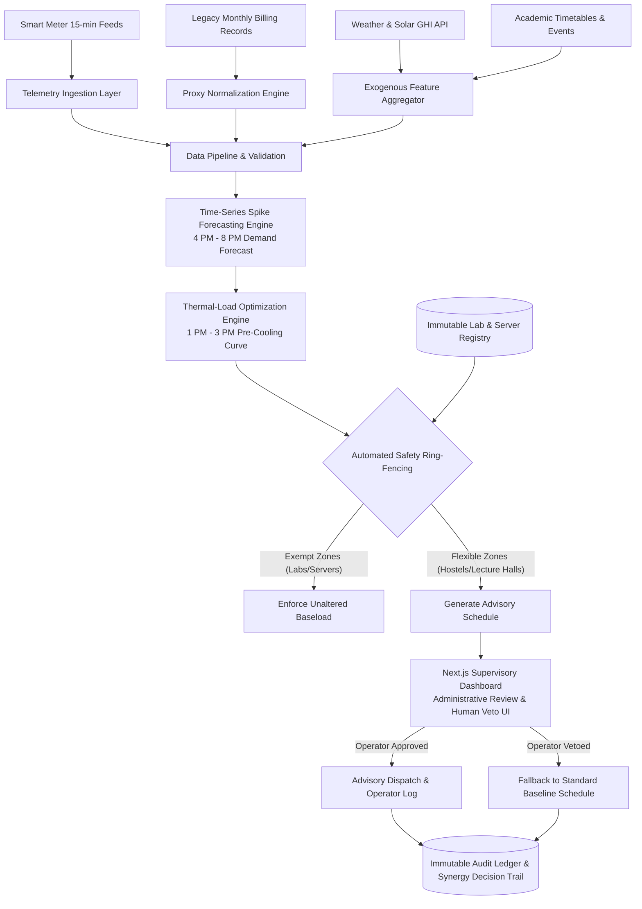

# Software Requirements Specification (SRS) & System Architecture Plan
**AI Synergy Hackathon 2026 | Case 05: "The 4 PM Spike"**  
**Project Title:** Campus Thermal-Load Optimization & Dynamic Peak Mitigation  
**System Designation:** Synergy Thermal-Shield v1.0.0 (Advisory & Simulation Mode)

---

## 1. System Overview & Target Users

### 1.1 Core Mission
The platform mitigates severe weekday electricity-demand spikes occurring between **4:00 PM and 8:00 PM** across an educational campus microgrid. By synthesizing predictive time-series forecasting, mathematical proxy telemetry normalization, and intelligent thermodynamic pre-cooling during surplus rooftop solar generation hours (**1:00 PM – 3:00 PM**), the system flattens the campus peak load curve without disrupting teaching, sensitive academic research, or student living welfare.

### 1.2 Primary User Personas & Stakeholder Mapping
| Persona | Stakeholder Group | Primary Operational Objective | System Interactivity & Authority |
| :--- | :--- | :--- | :--- |
| **Facilities Engineer** | Campus Facilities & Electrical Teams | Transformer load balancing, microgrid stability, chiller plant efficiency. | Daily morning review, advisory dispatch, physical setpoint application. |
| **Lab Director** | Research Laboratories & Academic Depts | Non-interruptible equipment power continuity, server room thermal limits. | Immutable ring-fence verification; zero load-shifting tolerance. |
| **Student Representative** | Hostel Residents & Student Welfare | Temperature comfort stability ($\pm 1.5^\circ\text{C}$ drift bound), study hours continuity. | Passive consumer; comfort telemetry feedback provider. |
| **Energy & Finance Officer** | Administration & Institutional Oversight | Peak demand tariff penalty avoidance, carbon accounting, audit compliance. | Macro KPI auditing, ROI metrics, historical decision trail inspection. |

---

## 2. System Inputs

1. **Real-Time Telemetry Feeds:**
   - 15-minute interval power consumption logs ($\text{kW}$), reactive power ($\text{kVAR}$), and bus voltages from smart-metered campus blocks (e.g., Engineering Towers, Central Library, New Hostel Blocks).
2. **Legacy Billing Aggregates:**
   - Monthly aggregate energy consumption totals ($\text{kWh}$) and utility billing ledgers from legacy/unmetered facilities (e.g., Old Administrative Block, Heritage Auditoriums).
3. **External Exogenous Streams:**
   - Real-time ambient weather feeds (temperature, relative humidity, heat index).
   - Global Horizontal Irradiance (GHI) and rooftop solar generation telemetry curves ($\text{kW}$).
   - Academic schedules (exam periods, vacation schedules, high-occupancy campus events).

---

## 3. System Outputs

1. **Dynamic Pre-Cooling Schedules:**
   - Optimized chiller setpoint ramps ($21.0^\circ\text{C}$ between 1:00 PM and 3:00 PM) followed by thermal coasting profiles ($24.0^\circ\text{C} \pm 0.5^\circ\text{C}$ between 4:00 PM and 8:00 PM).
2. **Peak Demand Advisory Alerts:**
   - Automated early-warning indicators flagged on supervisory dashboards when forecasted evening grid draw exceeds critical transformer thresholds ($> 1200\,\text{kW}$).
3. **Visualization & Supervisory Dashboards:**
   - Real-time Next.js operational console displaying live telemetry, solar cliff curves, baseline vs. pre-cooled load predictions, and comfort drift boundaries.
4. **Immutable Audit Logs:**
   - Cryptographically hashed (SHA-256) JSON audit trail recording all AI model inferences, human operator approvals, vetos, and parameter overrides.

---

## 4. End-to-End Workflow Architecture

---

## 5. Functional Requirements

### FR-01: Telemetry Normalization Engine
- **Specification:** The backend must ingest heterogeneous data types, decomposing monthly billing aggregates into 15-minute synthetic operational baselines using weather-correlated regression weights and building occupancy proxies.
- **Formula:** $\hat{P}_{t, \text{legacy}} = \frac{E_{\text{monthly}}}{H_{\text{month}}} \cdot w_{\text{occ}}(t) \cdot \phi(T_{\text{ambient}}(t))$
- **Validation:** Normalized synthetic series must maintain energy conservation ($\sum \hat{P}_t \Delta t = E_{\text{monthly}} \pm 1\%$).

### FR-02: Peak Demand Predictive Forecasting
- **Specification:** The predictive model must evaluate combined campus load between 4:00 PM and 8:00 PM, computing peak magnitude ($\text{kW}$), onset gradient ($\text{kW}/\text{hr}$), and solar drop-off delta.
- **Model Standard:** Gradient-boosted time-series regression with rolling autoregressive lags, temperature polynomial features, and calendar indicators.
- **Inference Latency SLA:** Complete multi-zone campus forecast generated in $\le 850\,\text{ms}$.

### FR-03: Thermal-Load Optimization
- **Specification:** The optimization engine calculates building-specific thermal inertia curves. Targeted pre-cooling is scheduled exclusively between **1:00 PM and 3:00 PM** when rooftop solar output is maximal ($> 450\,\text{kW}$), lowering indoor thermal mass to accumulate cooling energy and reducing compressor power demand by $\ge 15\%$ between 4:00 PM and 8:00 PM.
- **Thermal Boundary Constraints:** Indoor temperatures must never deviate beyond $21.0^\circ\text{C} \le T_{\text{indoor}} \le 24.5^\circ\text{C}$ (Thermal Drift Index $\le \pm 1.5^\circ\text{C}$).

### FR-04: Automated Safety Ring-Fencing
- **Specification:** The system maintains an unmodifiable metadata registry of non-interruptible critical zones (Chemistry Biorisk Freezers, Supercomputing Facility, Cleanroom Vivarium).
- **Enforcement:** Optimization algorithms must automatically filter out ring-fenced zone IDs before optimization routines execute. Any load-shedding or thermal drift command directed to a ring-fenced facility must immediately trigger a validation error and abort the recommendation.

### FR-05: Supervisory Dashboard & Human Override UI
- **Specification:** An administrative web interface (Next.js App Router, Tailwind CSS) providing:
  1. Live telemetry feeds vs. AI optimized trajectories.
  2. One-click schedule approval / veto controls with mandatory human notes.
  3. Interactive zone ring-fencing status badges.
  4. Real-time alert feed for projected transformer overloads.
  5. Cryptographic audit log inspector.

---

## 6. AI & Human Responsibilities Matrix

| Operational Dimension | AI System Responsibilities | Human Operator Responsibilities |
| :--- | :--- | :--- |
| **Telemetry Ingestion** | Automated schema validation, outlier imputation, missing packet imputation. | Physical sensor calibration, network telemetry gateway maintenance. |
| **Forecasting** | 24-hour predictive load curves, peak demand spike probability scoring. | Qualitative adjustment for unannounced campus events or campus emergencies. |
| **Thermal Optimization** | Thermodynamic pre-cooling curve optimization and solar surplus matching. | Final morning sign-off (09:00 AM daily briefing) and chiller dispatch approval. |
| **Safety Governance** | Automated ring-fence enforcement, parameter bounds validation ($\pm 1.5^\circ\text{C}$). | Absolute manual veto power; manual override capability at any moment. |
| **Audit Compliance** | Generating SHA-256 tamper-evident log records of all advisories. | Reviewing monthly compliance metrics and submitting reports to university trustees. |

---

## 7. System Constraints & Regulatory Boundaries

1. **Absolute Prohibition on Direct Hardware Actuation:**  
   The platform is strictly an **Advisory & Decision-Support System (DSS)**. Direct programmatic control of electrical circuit breakers, automatic relay trips, or unauthorized BACnet/Modbus writes without authenticated human sign-off is architecturally forbidden.
2. **Mandatory Simulation Watermarking:**  
   In compliance with Hackathon Boundary Rules, all control outputs, advisory schedules, simulated telemetry streams, and synthetic traces must carry the explicit header:  
   `X-Synergy-Simulation: True` and be watermarked with `[SIMULATED ADVISORY - NOT DIRECT ACTUATION]`.

---

## 8. Failure Handling & Fallback Mechanisms

1. **Missing Telemetry Fallback:**  
   If real-time 15-minute smart meter streams disconnect for $\ge 30\,\text{minutes}$, the normalization engine automatically falls back to 30-day historical weekday median profiles for affected buildings.
2. **Inference Latency & Timeout Fallback:**  
   If backend inference exceeds the $3000\,\text{ms}$ timeout threshold, the system gracefully aborts dynamic optimization and issues the certified static ASHRAE-55 conservative operating schedule.
3. **Weather Anomaly Safety Interlock:**  
   If ambient temperature exceeds $42.0^\circ\text{C}$ (Heatwave Alert Level 3) or humidity index exceeds dangerous thresholds, pre-cooling operations are automatically suspended to preserve equipment lifespans.

---

## 9. Quantitative Acceptance Criteria

| Metric | Target Specification | Measurement Protocol |
| :--- | :--- | :--- |
| **Peak Grid Reduction** | $\ge 15.0\%$ peak $\text{kWh}$ reduction | Total campus microgrid grid draw during 4:00 PM – 8:00 PM window compared against trailing 30-day normalized baseline. |
| **Thermal Drift Index (TDI)** | $\le \pm 1.5^\circ\text{C}$ from nominal setpoint | Continuous indoor sensor monitoring across student hostels and educational auditoriums. |
| **Critical Ring-Fence Safety** | $0$ violations ($100\%$ isolation) | Zero setpoint modifications or shed commands issued to registered lab/server assets. |
| **Audit Trail Integrity** | $100\%$ cryptographic traceability | Verification of hash chains across the Synergy Decision Trail index for every issued advisory. |

---

## 10. Version-1 (V1) Exclusions

- Direct IoT smart-plug firmware manipulation or edge relay switching.
- Automated building-wide main breaker tripping or autonomous substation load shedding.
- Edge-AI embedded microcontroller firmware deployments (V1 leverages containerized FastAPI cloud/server services).

---

## 11. Synergy Decision Trail Index

| Decision ID | Operational Topic | Initial Engineering View | AI Advisory Contribution | Evidence & Verification | Final Human System Decision |
| :--- | :--- | :--- | :--- | :--- | :--- |
| **SDT-001** | Peak Mitigation Strategy | Automated aggressive circuit breaker cuts to non-essential dorms. | Identified regulatory boundaries and comfort violations; proposed 1-3 PM solar pre-cooling. | Case boundary rules prohibiting direct control; thermodynamic thermal mass storage feasibility. | **Adopted non-invasive solar pre-cooling & human-approved advisory dispatch.** |
| **SDT-002** | Uneven Campus Metering | Delay project until multi-million dollar AMI smart meter upgrade. | Designed software proxy normalization using weather regression & occupancy profiles. | Case data demonstrating coexistence of 15-min and monthly billing records. | **Approved software-level proxy telemetry engine for V1 MVP.** |
| **SDT-003** | Critical Research Facilities | Apply uniform load-shifting percentages across all campus facilities. | Flagged severe hazard to biosafety freezers and server clusters; engineered automated ring-fencing. | Case evidence confirming sensitive experiments and non-interruptible lab infrastructure. | **Enforced strict programmatic ring-fence with zero allowable load shift for labs.** |
